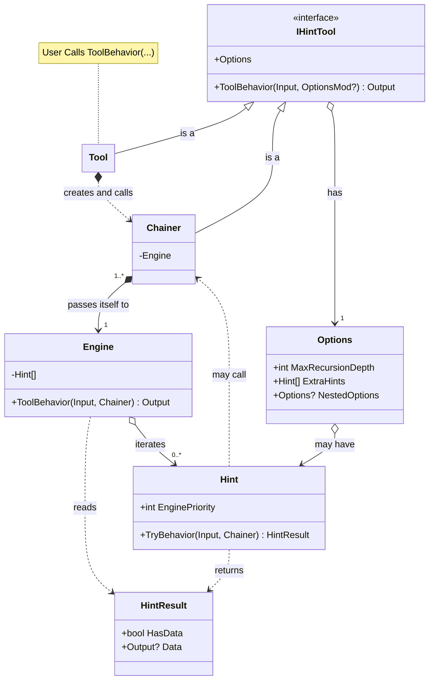

# Hint Tools

## Overview

A `Hint` in the framework knows how to do the `Tool` behavior for a specific <xref:System.Type> or piece of data. So anytime the framework cannot handle a specific case, a new `Hint` can be made tailored to it without disrupting the existing flow. All hint-based tools share a common architecture enforced via inheritance: 

<xref:Werecodent.CreateAndFake.Design.Tooling>

### Architecture Class Diagram

> ### Responsibilities
>
> * `Options` - Feature flags accessible to all.
> * `Tool` - Handles initial setup and finalization.
> * `Chainer` - Handles recursion.
> * `Engine` - Handles running hints.
> * `Hint` - Handles specific cases.

## Recursion

Providing the full `Tool` behavior to a `Hint` is critical in allowing each `Hint` to handle the internal states for its supported cases. The `Chainer` provides this, as well as any additional behavior necessary for the tool's hints in general, along with a mechanism to prevent infinite recursion problems such a design would normally create. Each individual `Tool` usually has its own requirements on how this is accomplished (generally keeping a history), but the core mechanism is that for each recursive pass the `Chainer` creates a new `Chainer` based upon itself and passes it to the `Engine`. Each `Chainer` can then be isolated per layer if necessary for the `Tool` behavior.
